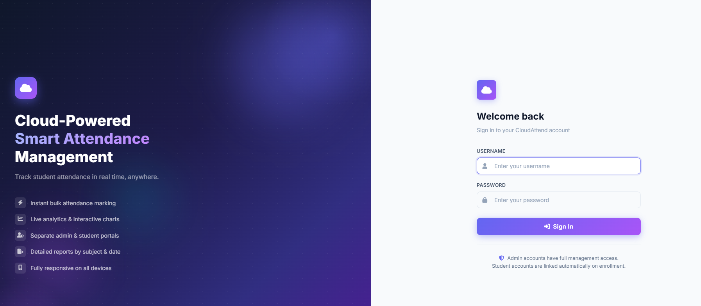
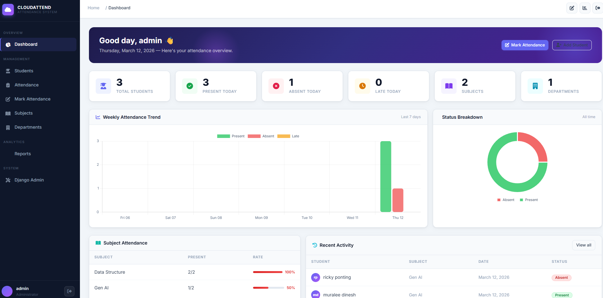
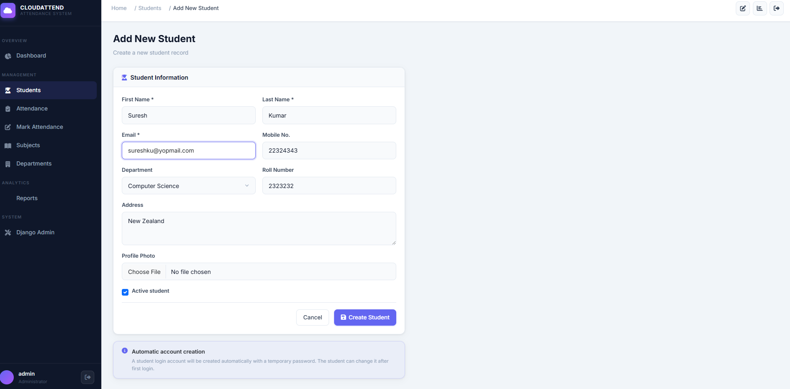
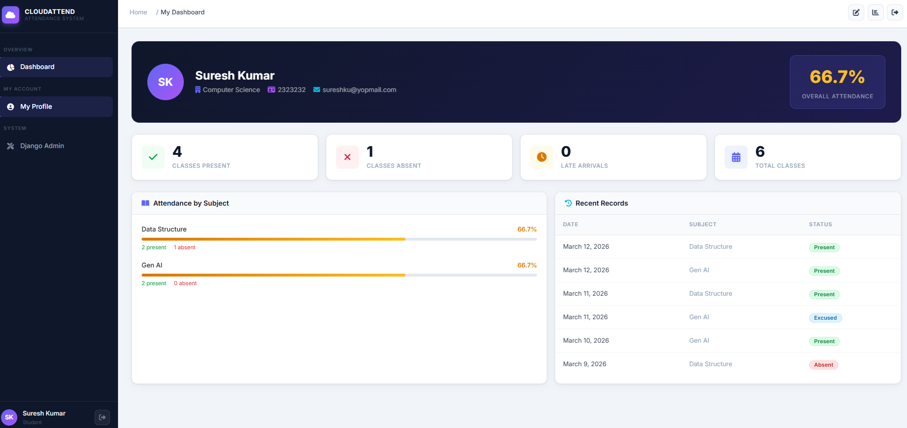

# Student Attendance System

A Django web application for managing students, departments, subjects, and class attendance. It provides separate student and administrator experiences, attendance reports, and a REST API.

## Features

- Separate student and administrator login pages and dashboards
- Student self-registration; administrator registration requests require approval by an existing staff administrator
- Student, department, and subject management
- Attendance marking for a class with **Present**, **Absent**, **Late**, and **Excused** statuses
- Student attendance history and attendance percentage
- Reports with subject and date filters
- Student accounts created when an administrator enrolls a student
- Optional student welcome emails over SMTP; emails are written to the console in local development by default
- Django REST Framework API for students, attendance, subjects, departments, and enrollments
- SQLite for local use; optional MySQL configuration for deployment
- AWS Elastic Beanstalk and CloudFormation deployment files

## Screenshots

| Login | Administrator dashboard |
|---|---|
|  |  |

| Add a student | Student dashboard |
|---|---|
|  |  |

## Technology

- Python and Django 5.0
- Django REST Framework
- SQLite locally; MySQL-compatible Amazon Aurora in the provided AWS deployment
- HTML, CSS, JavaScript, Bootstrap, and Chart.js
- WhiteNoise for static files

## Run locally

### Requirements

- Python 3.12 (the AWS deployment is configured for Python 3.12)
- `pip`

### Install

From the project directory, create and activate a virtual environment, then install the dependencies:

```powershell
python -m venv .venv
.\.venv\Scripts\Activate.ps1
python -m pip install -r requirements.txt
```

If PowerShell blocks virtual-environment activation, you can invoke the environment's Python directly:

```powershell
.\.venv\Scripts\python.exe -m pip install -r requirements.txt
```

Copy `.env.example` to `.env`. The default local configuration uses SQLite and prints email messages to the terminal. Before using the application beyond local development, set a unique Django secret key in `.env`. Generate one with:

```powershell
python -c "import secrets; print(secrets.token_urlsafe(50))"
```

Set the resulting value as `SECRET_KEY` in `.env`. Keep `.env` private; it is excluded by `.gitignore`.

### Initialize and start

```powershell
python manage.py migrate
python manage.py createsuperuser
python manage.py runserver
```

Open [http://127.0.0.1:8000/](http://127.0.0.1:8000/). The root page takes you to the account sign-in page. The Django administration site is at [http://127.0.0.1:8000/admin/](http://127.0.0.1:8000/admin/).

To run the automated tests and Django configuration check:

```powershell
python manage.py test api_v1
python manage.py check
```

## Accounts and roles

- **Administrator:** Create the initial administrator with `python manage.py createsuperuser`. Staff administrators can manage the system and approve pending administrator signup requests in Django Admin.
- **Student:** Students can register at `/accounts/student/signup/` or sign in at `/accounts/student/login/`. The student dashboard shows their own attendance information.
- **Administrator signup:** Requests submitted at `/accounts/admin/signup/` remain pending until an existing staff administrator approves them in Django Admin.
- **Enrolled students:** When an administrator creates a student record without a linked account, the application creates a student login and sends a welcome email. The generated temporary password is based on the student ID, so it is predictable and must not be treated as a secure production credential. Arrange a secure password reset/change process before using real student accounts.

## Configuration

The application reads environment variables first and then loads values from `.env` for local development. The complete safe template is in `.env.example`.

| Variable | Purpose |
|---|---|
| `SECRET_KEY` | Django signing key. Set a unique, secret value. |
| `DEBUG` | Django debug mode; disable in production. |
| `ALLOWED_HOSTS` | Comma-separated allowed host names. Configure explicitly in production. |
| `RDS_HOSTNAME` | When present, selects the MySQL database configuration. |
| `RDS_DB_NAME` | MySQL database name. |
| `RDS_USERNAME` | MySQL username. |
| `RDS_PASSWORD` | MySQL password. |
| `RDS_PORT` | MySQL port, normally `3306`. |
| `EMAIL_HOST` | SMTP server. If unset, email is printed to the console. |
| `EMAIL_PORT` | SMTP port; defaults to `587`. |
| `EMAIL_USE_TLS` | Enable SMTP TLS; defaults to `True` when SMTP is configured. |
| `EMAIL_USE_SSL` | Enable SMTP SSL; defaults to `False`. |
| `EMAIL_HOST_USER` | SMTP account username. |
| `EMAIL_HOST_PASSWORD` | SMTP password or provider app password. |
| `DEFAULT_FROM_EMAIL` | Sender address used for outgoing email. |
| `ATTENDANCE_ADMIN_EMAILS` | Optional comma-separated administrator addresses copied on welcome messages. |
| `SITE_URL` | Base URL included in welcome emails; defaults to `http://localhost:8000`. |

For local development, leave the `RDS_*` variables unset to use SQLite. Never commit `.env`, database files, passwords, or production credentials.

## REST API

API endpoints are under `/api/v1/`. The default Django REST Framework configuration requires authentication and supports session and token authentication. List responses are paginated (20 items per page).

| Method | Endpoint | Description |
|---|---|---|
| `GET`, `POST` | `/api/v1/students/` | List or create students |
| `GET`, `PUT`, `PATCH`, `DELETE` | `/api/v1/students/<student_id>/` | Retrieve, update, or delete a student |
| `GET`, `POST` | `/api/v1/attendance/` | List or create attendance records |
| `GET`, `PUT`, `PATCH`, `DELETE` | `/api/v1/attendance/<id>/` | Retrieve, update, or delete an attendance record |
| `GET`, `POST` | `/api/v1/subjects/` | List or create subjects |
| `GET`, `PUT`, `PATCH`, `DELETE` | `/api/v1/subjects/<subject_code>/` | Retrieve, update, or delete a subject |
| `GET`, `POST` | `/api/v1/departments/` | List or create departments |
| `GET`, `POST` | `/api/v1/enrollments/` | List or create student-subject enrollments |

To create a token for an existing user in a local development database:

```powershell
python manage.py shell -c "from django.contrib.auth import get_user_model; from rest_framework.authtoken.models import Token; user = get_user_model().objects.get(username='YOUR_USERNAME'); print(Token.objects.get_or_create(user=user)[0].key)"
```

Use the token in an authenticated request:

```powershell
curl.exe http://127.0.0.1:8000/api/v1/students/ -H "Authorization: Token YOUR_TOKEN"
```

Keep API tokens private. The token command above is for development; use secure credential handling for production.

## AWS deployment

This repository includes:

- `cloudformation/template.yaml` — AWS infrastructure template for Elastic Beanstalk and Aurora Serverless v2
- `.ebextensions/django.config` — Elastic Beanstalk configuration, including migrations and static-file collection
- `.github/workflows/deploy.yml` — manually triggered deployment workflow with `all`, `infra-only`, and `app-only` scopes
- `.github/workflows/destroy.yml` — manually triggered infrastructure teardown workflow

AWS deployment is optional and incurs AWS charges. Review the CloudFormation template and both workflows before using them. Configure the AWS and application secrets required by the workflow in the repository's **Settings → Secrets and variables → Actions**; never put secret values in this README or commit them to Git. The deployment workflow is started from the repository's **Actions** tab and does not deploy automatically on each push.

## Main directories

```text
Attendance_System/    Django project settings and URL configuration
api_v1/               Models, views, forms, REST API, and tests
templates/            Django HTML templates
static/               CSS, JavaScript, and static assets
diagrams/              Application screenshots
docs/                  Architecture and system-flow diagrams
cloudformation/        AWS CloudFormation template
.ebextensions/         Elastic Beanstalk configuration
.github/workflows/     GitHub Actions deployment workflows
```
